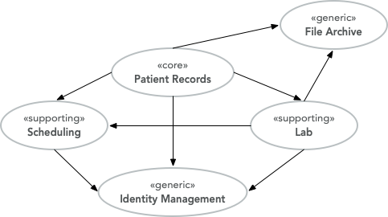

# DDD-CrashCourse

An article series introducing **strategic Domain-Driven Design** — the part
that comes before aggregates, entities and repositories: what a domain is, how
to split it into subdomains, and how to classify and prioritise them.

The material is based on Eric Evans' *Domain-Driven Design: Tackling
Complexity in the Heart of Software* and Vaughn Vernon's *Implementing
Domain-Driven Design*, explained in the author's own words with an extended
example.

## Chapters

| Chapter | Topic |
|---|---|
| [1 — Strategic Domain-Driven Design](chapter-1.md) | the domain concept, core/supporting/generic subdomains, classifying the subdomains of an EMR system, and moving from problems to solutions |



## Reading it

The chapters are plain Markdown; GitHub renders them, including the diagram.
Start with [chapter-1.md](chapter-1.md) and read top to bottom — each section
builds on the previous one, and the EMR example runs through the whole chapter.

## Repository layout

```
chapter-1.md          the first chapter
ch-1-subdomains.png   the EMR subdomain diagram used in it
```

## License

MIT — see [LICENSE](LICENSE).
